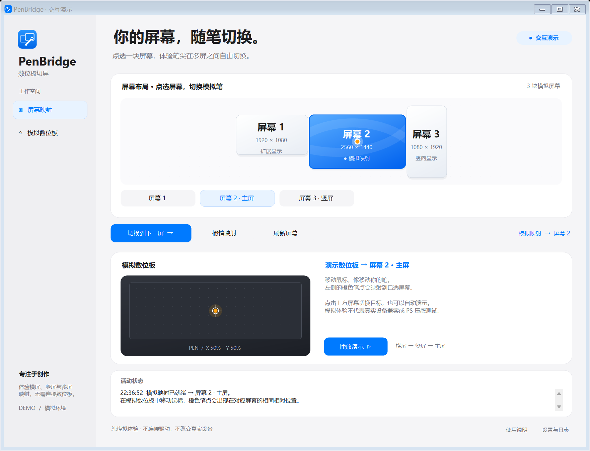
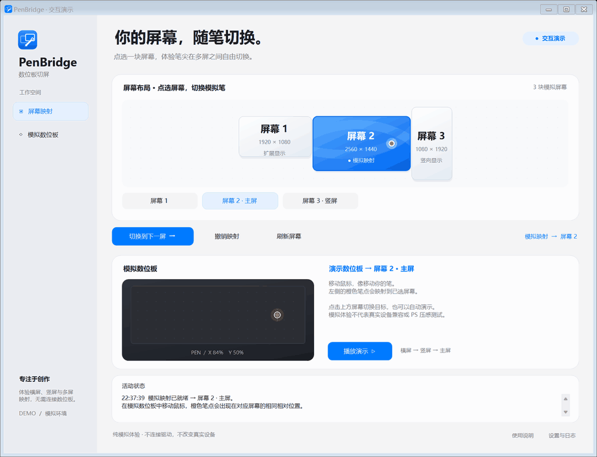

# PenBridge · 数位板切屏

**点一下屏幕，让笔跟过去。**

面向 Windows 多屏绘画工作台的轻量工具。以浅色卡片、圆角与清晰留白呈现屏幕布局，点击目标屏幕切换数位板映射；支持托盘、快捷键和独立交互演示。

[下载 Windows 版](https://github.com/manba-pan/tablet-screen-switcher/releases/latest) · [查看演示](docs/demo.gif) · [版本说明](RELEASE_NOTES.md)



## 快速开始

1. 在 Releases 下载 `PenBridge.exe`，双击运行。系统要求：Windows 10/11、.NET Framework 4.8。
2. 想先体验操作，下载并运行 `PenBridge-Demo.exe`；无需连接数位板或安装驱动。点击模拟屏幕，再在数位板区域移动鼠标，也可以点击「自动演示」。
3. 需要附带文档和演示素材，下载 `PenBridge-0.3.0-Windows.zip` 并解压。

程序无需 Python、Anaconda、浏览器服务或安装器。演示中的三屏与笔输入均为模拟，使用独立临时配置，不读取真实设置、不调用驱动、不发送系统快捷键。



## 能兼容哪些数位板

PenBridge 采用可扩展的驱动适配设计，**目前不能保证所有品牌、型号及驱动版本免配置通用**。真实切屏取决于已有驱动提供的接口。

| 连接方式 | 功能 | 使用前提 |
| --- | --- | --- |
| OpenTabletDriver 0.6.x | 点选屏幕、循环切换、配置回读核验、撤销上一次映射 | 已运行的兼容 OTD daemon 与 Console、OTD 支持的数位板、绝对定位输出模式 |
| 原厂驱动快捷键 | 调用驱动的循环切屏功能 | 驱动必须提供可由外部触发的全局键盘快捷键；无法指定或回读目标屏幕 |

原厂驱动中分配给数位板实体按键的「切换屏幕」，不一定等价于全局键盘快捷键。当前没有 Wacom、Huion、XPPen 等品牌的私有 API 适配器。

### 使用 OTD 点选屏幕

1. 先在 OTD 中配置好数位板，确认输入正常。
2. 在 PenBridge 选择 OTD，填写 `OpenTabletDriver.Console.exe` 路径与配置中完整、唯一的数位板名称。
3. 点击「检查连接」，然后在布局图中选择目标屏幕。
4. 悬空移动笔检查落点，再在 Photoshop 中检查轻重笔画与压感。

适配器使用 `savesettings` 和 `setdisplayarea`，已按 OTD 0.6.x 接口实现；支持内置绝对定位与 `VoiDPlugins.OutputMode.WinInkAbsoluteMode`。相对定位和未确认的输出模式会被拒绝。

**Windows 上的 OTD 绘画压感需要额外配置 VMulti、WindowsInk 插件，并让绘画软件使用 Windows Ink。** 内置绝对定位本身不提供压感。请按 [OTD 官方 Windows 说明](https://opentabletdriver.net/Wiki/FAQ/Windows) 配置，避免原厂驱动与 OTD 同时争用同一设备。

切换修改所选数位板的显示区域，保留原有数位板工作区、压力曲线、按键和过滤器。切换前备份配置，切换后回读核验；配置核验不能代替实笔落点与压感检查。修改仅作用于 daemon 当前会话，需要永久保存时请在 OTD 中保存。

### 使用原厂驱动循环切屏

1. 在原厂驱动中设置一个全局键盘切屏快捷键，先直接按键确认有效。
2. 在 PenBridge 选择原厂驱动方式，填入同一组合并确认已配置。
3. 检查连接后使用「下一屏」，或按 `Ctrl+Alt+F9`。

检查连接只检查配置及可选的驱动进程；「已发送请求」表示快捷键已发出，不代表驱动完成映射。工具不会连续补发请求。原厂方式按驱动自身顺序循环，无法从布局图直接指定某一屏。

## 日常使用

| 操作 | 方式 |
| --- | --- |
| 下一屏 | 窗口或托盘菜单，或 `Ctrl+Alt+F9` |
| 打开窗口 | 托盘菜单，或 `Ctrl+Alt+F10` |
| 指定屏幕 | 点击布局图中的目标屏幕，仅 OTD 方式支持 |
| 撤销 | 恢复本次运行的上一次 OTD 显示区域；外部修改后不会强行覆盖 |

屏幕按桌面位置排列，编号不保证等于 Windows 设置中的编号。切屏时请先抬笔；不同比例的屏幕可能改变笔迹比例，需要在 OTD 中核对工作区比例。

插拔显示器、旋转、改变分辨率或布局后，请重新检查连接并核对 OTD 的显示器列表；部分拓扑变化需要重启 daemon。程序不会自动重启、安装或卸载驱动。

设置、日志和配置备份保存在 `%LOCALAPPDATA%\TabletScreenSwitcher`，沿用旧版目录以保留已有配置。这些本地数据不随发布包分发。提交问题时请先移除日志中的个人路径和设备信息。

## 从源码构建

使用 Windows 自带的 .NET Framework C# 编译器，无第三方运行时包依赖。在源码目录打开 PowerShell：

```powershell
powershell.exe -NoProfile -ExecutionPolicy Bypass -File .\build.ps1
powershell.exe -NoProfile -ExecutionPolicy Bypass -File .\test.ps1
powershell.exe -NoProfile -ExecutionPolicy Bypass -File .\test-demo.ps1
powershell.exe -NoProfile -ExecutionPolicy Bypass -File .\test-release.ps1
powershell.exe -NoProfile -ExecutionPolicy Bypass -File .\package.ps1
```

构建产物包括 `PenBridge.exe` 与 `PenBridge-Demo.exe`，发布文件在 `releases`。`ExecutionPolicy Bypass` 仅作用于本次 PowerShell 进程。GitHub Actions 会执行构建、逻辑测试、演示测试与打包。

命令行示例（先退出正在运行的托盘实例）：

```powershell
.\PenBridge.exe --demo
.\PenBridge.exe --list --out .\screens.json
.\PenBridge.exe --check --out .\check.json
.\PenBridge.exe --next --out .\next.json
.\PenBridge.exe --screen 1 --out .\switch.json
```

`--next` 和 `--screen` 会操作真实驱动；`--demo` 是独立模拟，不能与这些命令混用。

可选演示录制：

```powershell
.\PenBridge-Demo.exe --demo-record .\demo-frames --out .\demo-recording.json
# 等待录制程序退出后执行；仅此编码步骤需要 Python 与 Pillow。
python render_demo.py .\demo-frames .\docs\demo.gif
```

## 验证范围

项目包含 31 项核心逻辑与子进程集成检查，以及 26 项演示界面与隔离检查。测试中的多屏与 OTD 使用模拟数据；**真实多屏数位板切换与 Photoshop 实笔压感尚未完成硬件验证**。

另有发布检查覆盖单 EXE 运行、内嵌帮助、版本信息以及演示文件改名后的隔离。独立演示程序在编译时固定为模拟模式，重命名或重复下载不会切换成真实驱动模式。

实机验收建议覆盖每屏四角与中心、连续切换、混合缩放、左侧或上方屏幕、横竖屏、不同比例、休眠与插拔，以及 Photoshop 压感和笔侧键。

## 参考

- [OTD Windows 压感与驱动冲突](https://opentabletdriver.net/Wiki/FAQ/Windows)
- [OTD 命令行接口](https://opentabletdriver.net/Wiki/Documentation/CommandLine)
- [OTD 显示拓扑限制](https://opentabletdriver.net/Wiki/FAQ/General)
- [Windows 数位设备与显示器映射](https://learn.microsoft.com/en-us/windows-hardware/design/component-guidelines/digitizer-display-mapping)
